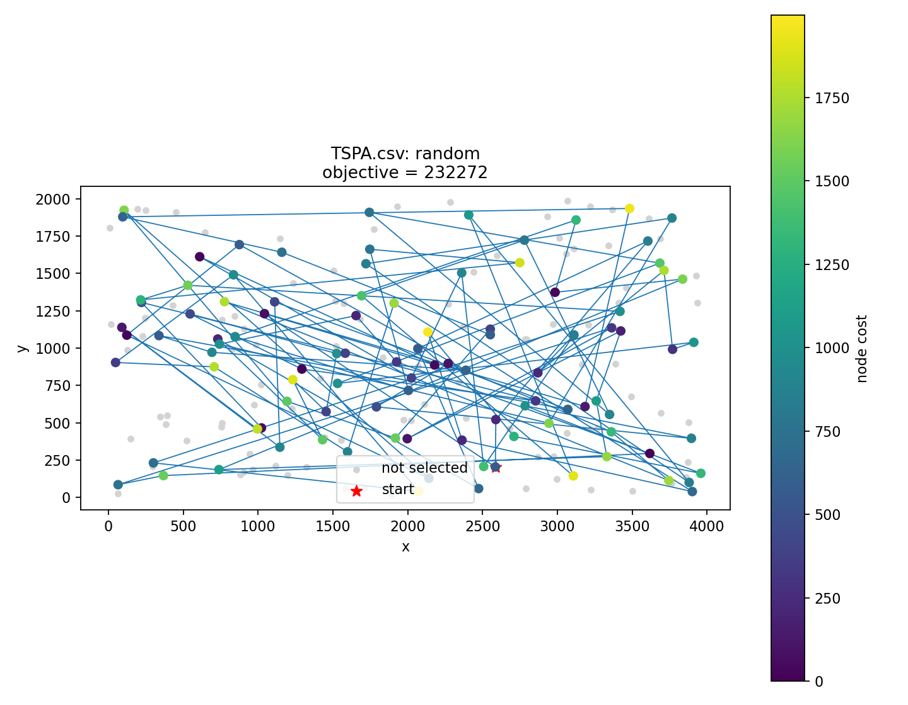
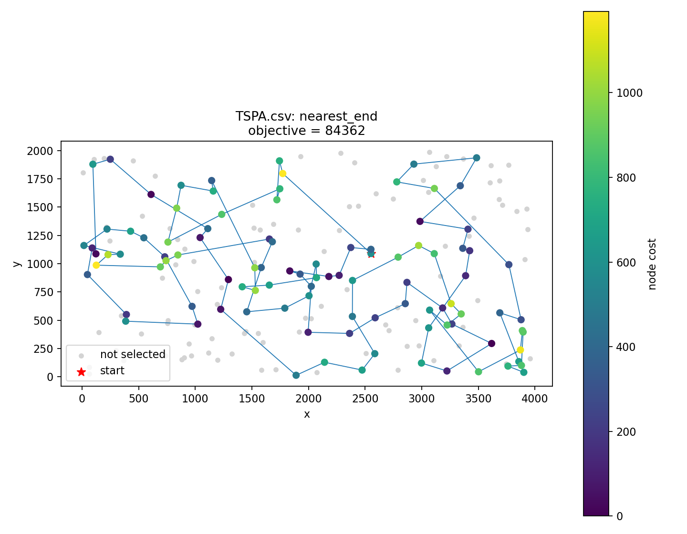
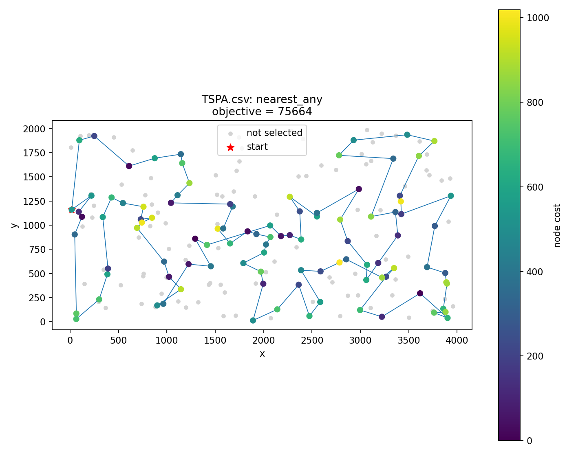
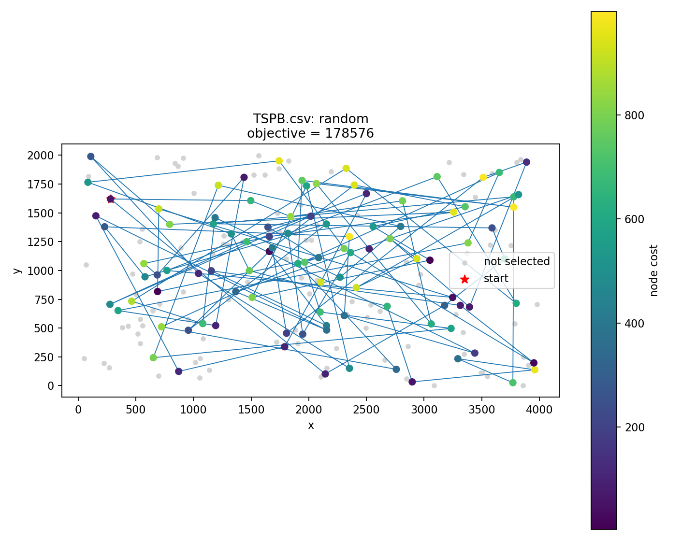
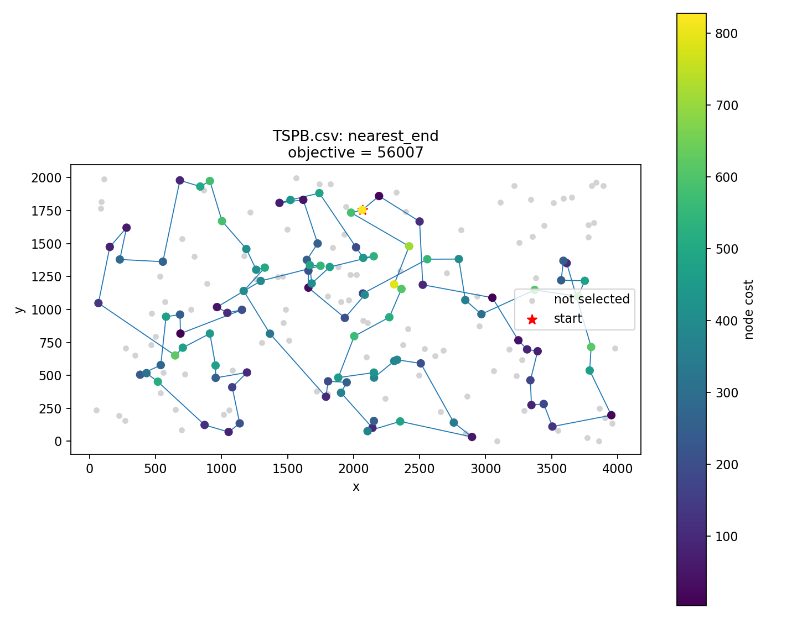
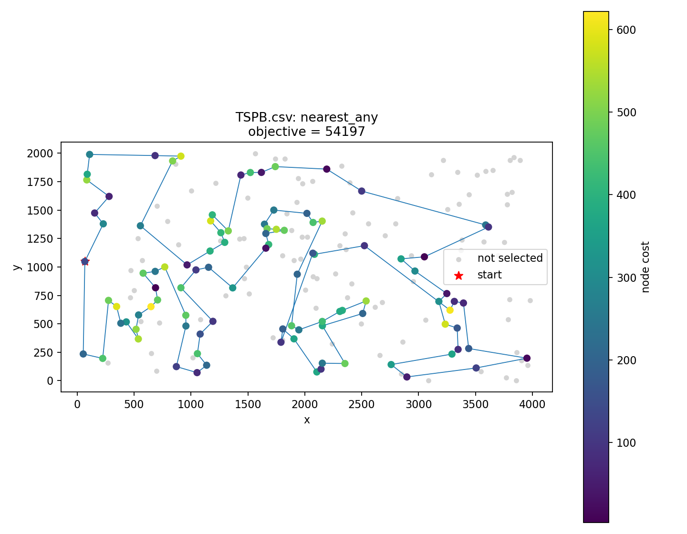
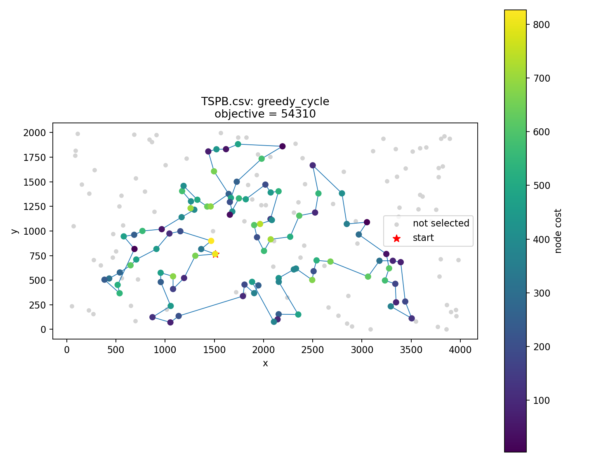

# Lab 1: Greedy heuristics

## Problem description

Each instance consists of 200 nodes. A row in the input file contains the node's planar coordinates and selection cost, in the form `x;y;cost`. Node indices are zero-based and correspond to row order. The task is to select exactly 100 distinct nodes (half of the available nodes), order them, and form a closed cycle that minimizes the sum of travel distances and selected-node costs.

## Pseudocode

### Random solution

```text
RANDOM(V, m):
    P = random shuffle of V
    S = first m elements of P
    return S, evaluate(S)
```

### Nearest neighbor: append at the end

```text
NEAREST_END(start):
    S = [start]
    U = V minus {start}
    while length(S) < m:
        v = argmin over U of (d(last(S), v) + c[v])
        append v to S
        remove v from U
    return S, evaluate(S)
```

### Nearest neighbor: insertion near any selected node

For each unused node `v`, a cache stores its smallest value of `d(u,v) + c[v]` over selected nodes `u`, together with the corresponding anchor. Select the node with the smallest cached score and compare insertion immediately before and after its anchor in the open path.

```text
NEAREST_ANY(start):
    path = [start]
    unused = V minus {start}

    for node in unused:
        cache[node].nearestSelectedNode = start
        cache[node].connectionCost = d(start, node) + c[node]

    while length(path) < m:
        newNode = node in unused with smallest cache[node].connectionCost
        neighbor = cache[newNode].nearestSelectedNode

        costBefore = d(neighbor, newNode)
        if neighbor is not first in path:
            previous = node immediately before neighbor in path
            costBefore += d(previous, newNode) - d(previous, neighbor)

        costAfter = d(neighbor, newNode)
        if neighbor is not last in path:
            next = node immediately after neighbor in path
            costAfter += d(newNode, next) - d(neighbor, next)

        if costAfter < costBefore:
            insert newNode immediately after neighbor in path
        else:
            insert newNode immediately before neighbor in path
        remove newNode from unused

        for node in unused:
            connectionThroughNewNode = d(newNode, node) + c[node]
            if connectionThroughNewNode < cache[node].connectionCost:
                cache[node].nearestSelectedNode = newNode
                cache[node].connectionCost = connectionThroughNewNode

    return path, evaluate(path)
```

### Greedy cycle

The implementation initializes a two-node cycle, then chooses the globally cheapest insertion into any current cycle edge, including the closing edge.

```text
GREEDY_CYCLE(start):
    t = argmin over V minus {start} of d(start, t)
    S = [start, t]
    U = V minus {start, t}
    while length(S) < m:
        bestDelta = infinity
        for v in U, in increasing index order:
            for i = 0, ..., length(S)-1:
                a = S[i]
                b = S[(i+1) mod length(S)]
                delta = d(a,v) + d(v,b) - d(a,b) + c[v]
                if delta < bestDelta:
                    remember v and insertion position i+1
                    bestDelta = delta
        insert the remembered node at the remembered position
        remove it from U
    return S, evaluate(S)
```

## Results

| Instance | Method | Runs | Minimum | Maximum | Mean |
|---|---|---:|---:|---:|---:|
| TSPA | Random solution | 200 | 232272 | 292568 | 261848.80 |
| TSPA | Nearest neighbor: end | 200 | 84362 | 90075 | 87476.63 |
| TSPA | Nearest neighbor: any | 200 | 75664 | 80051 | 77693.10 |
| TSPA | Greedy cycle | 200 | 72726 | 76277 | 74005.23 |
| TSPB | Random solution | 200 | 178576 | 231858 | 206620.77 |
| TSPB | Nearest neighbor: end | 200 | 56007 | 63166 | 59397.33 |
| TSPB | Nearest neighbor: any | 200 | 54197 | 58230 | 56210.50 |
| TSPB | Greedy cycle | 200 | 54310 | 63734 | 59743.99 |

## Visualizations

### TSPA

#### Random solution

Objective: **232272**. Run: `90`. Construction start: `not applicable`.



```text
[
  158, 134, 101, 52, 192, 123, 96, 191, 87, 156, 152, 180, 176, 35, 60, 187, 40, 149, 189, 76,
  150, 49, 160, 131, 91, 63, 181, 199, 145, 121, 9, 54, 71, 31, 79, 106, 14, 122, 103, 36,
  45, 170, 72, 26, 65, 74, 58, 78, 190, 98, 12, 168, 38, 118, 69, 169, 66, 82, 109, 112,
  140, 90, 24, 164, 6, 92, 124, 43, 50, 135, 3, 129, 110, 107, 144, 51, 83, 0, 55, 139,
  193, 154, 105, 133, 186, 113, 115, 46, 102, 37, 47, 155, 174, 85, 20, 62, 53, 80, 177, 132
]
```

#### Nearest neighbor: end

Objective: **84362**. Run: `54`. Construction start: `54`.



```text
[
  54, 9, 33, 36, 177, 67, 144, 53, 135, 58, 134, 176, 174, 106, 89, 107, 57, 182, 151, 93,
  50, 3, 1, 164, 178, 29, 136, 186, 184, 47, 159, 130, 153, 78, 88, 193, 170, 146, 75, 64,
  150, 42, 113, 43, 85, 142, 8, 131, 84, 158, 192, 181, 114, 141, 180, 132, 76, 80, 48, 31,
  63, 149, 168, 97, 127, 187, 30, 123, 152, 108, 60, 116, 49, 11, 119, 160, 83, 90, 51, 16,
  35, 87, 45, 140, 52, 179, 185, 28, 102, 156, 157, 71, 91, 38, 100, 4, 112, 139, 115, 5
]
```

#### Nearest neighbor: any (implemented variant)

Objective: **75664**. Run: `49`. Construction start: `49`.



```text
[
  116, 60, 149, 63, 168, 129, 104, 69, 127, 97, 49, 108, 152, 100, 123, 90, 83, 160, 30, 187,
  189, 171, 2, 141, 87, 180, 28, 52, 177, 36, 131, 33, 143, 54, 9, 164, 8, 174, 150, 151,
  106, 93, 3, 85, 178, 186, 136, 29, 55, 101, 1, 169, 50, 147, 47, 130, 159, 146, 170, 153,
  193, 88, 78, 107, 57, 182, 89, 113, 42, 176, 72, 134, 84, 158, 192, 58, 181, 114, 135, 73,
  45, 140, 53, 179, 144, 67, 185, 156, 35, 16, 51, 132, 76, 4, 71, 157, 91, 80, 48, 31
]
```

#### Greedy cycle

Objective: **72726**. Run: `104`. Construction start: `104`.


```text
[
  104, 69, 127, 97, 160, 123, 83, 90, 30, 187, 171, 2, 189, 141, 87, 45, 73, 135, 114, 181,
  192, 158, 58, 84, 134, 72, 176, 150, 151, 182, 57, 64, 107, 88, 78, 193, 153, 170, 146, 159,
  130, 113, 89, 42, 106, 93, 47, 147, 50, 3, 169, 1, 178, 101, 29, 163, 136, 186, 164, 8,
  174, 131, 54, 9, 33, 36, 177, 52, 179, 53, 140, 144, 67, 16, 51, 156, 35, 185, 102, 28,
  180, 132, 76, 4, 71, 157, 91, 80, 48, 31, 152, 108, 60, 49, 11, 63, 149, 116, 168, 129
]
```

### TSPB

#### Random solution

Objective: **178576**. Run: `4`. Construction start: `not applicable`.



```text
[
  149, 87, 80, 143, 196, 191, 139, 93, 74, 112, 171, 84, 124, 183, 13, 16, 75, 173, 25, 182,
  91, 195, 104, 27, 130, 141, 102, 44, 56, 194, 117, 167, 135, 110, 129, 47, 152, 69, 71, 86,
  177, 145, 0, 34, 14, 168, 178, 72, 133, 3, 170, 123, 127, 26, 57, 22, 85, 175, 28, 181,
  64, 61, 35, 159, 144, 90, 105, 199, 59, 160, 83, 18, 185, 54, 49, 156, 88, 140, 37, 15,
  12, 172, 55, 125, 121, 40, 103, 41, 169, 113, 99, 122, 43, 193, 32, 76, 150, 77, 92, 63
]
```

#### Nearest neighbor: end

Objective: **56007**. Run: `32`. Construction start: `32`.



```text
[
  32, 89, 57, 76, 54, 127, 129, 90, 153, 20, 14, 2, 110, 118, 56, 114, 196, 10, 148, 143,
  78, 192, 162, 104, 185, 184, 3, 151, 69, 172, 133, 120, 96, 121, 198, 48, 72, 46, 86, 117,
  160, 136, 8, 21, 154, 140, 47, 170, 125, 177, 6, 132, 29, 197, 175, 134, 45, 60, 40, 71,
  155, 97, 115, 180, 65, 28, 149, 145, 158, 116, 147, 42, 50, 130, 30, 183, 38, 64, 85, 59,
  167, 51, 87, 179, 82, 88, 171, 99, 67, 24, 34, 181, 152, 73, 98, 27, 135, 75, 79, 156
]
```

#### Nearest neighbor: any (implemented variant)

Objective: **54197**. Run: `158`. Construction start: `158`.



```text
[
  65, 145, 28, 149, 13, 146, 37, 116, 42, 147, 158, 154, 38, 21, 30, 191, 130, 183, 121, 198,
  96, 48, 89, 57, 196, 114, 54, 162, 192, 127, 80, 182, 153, 20, 74, 99, 171, 2, 110, 14,
  90, 129, 52, 76, 3, 184, 85, 59, 51, 82, 87, 179, 88, 181, 67, 66, 24, 34, 152, 167,
  73, 151, 86, 46, 72, 120, 133, 136, 8, 117, 172, 160, 69, 64, 47, 140, 97, 40, 60, 157,
  45, 134, 175, 71, 155, 26, 125, 177, 170, 115, 180, 6, 197, 36, 29, 132, 103, 178, 174, 1
]
```

#### Greedy cycle

Objective: **54310**. Run: `49`. Construction start: `49`.



```text
[
  49, 64, 4, 47, 140, 97, 115, 180, 6, 29, 132, 36, 197, 170, 177, 125, 26, 154, 38, 21,
  176, 30, 191, 130, 183, 189, 168, 133, 63, 121, 198, 96, 48, 89, 156, 120, 136, 172, 160, 69,
  8, 117, 72, 46, 86, 184, 3, 173, 122, 151, 98, 111, 27, 135, 76, 185, 57, 104, 162, 54,
  192, 127, 52, 182, 153, 20, 74, 2, 14, 90, 129, 80, 150, 84, 66, 67, 31, 24, 34, 152,
  181, 88, 179, 87, 82, 73, 167, 51, 59, 85, 45, 134, 175, 157, 71, 155, 141, 60, 40, 33
]
```

## Solution checking

Solutions were checked with given Excel solution checker, but we implemented also our own solution checker in `types.hpp`, which gives exactly the same results

## Source code

Repository: [PiotrFoltyniewicz/Evolutionary-Computation](https://github.com/PiotrFoltyniewicz/Evolutionary-Computation).

Greedy methods are located in `greedy_methods.cpp`

## Conclusions

- Every greedy method substantially outperformed random sampling on both instances: even the worst recorded greedy solution was better than the best recorded random solution.
- On TSPA, greedy cycle achieved the lowest minimum (72,726) and mean (74,005.23). Its mean was approximately 71.74% below the random mean. The implemented `nearest_any` variant ranked second, followed by `nearest_end`.
- On TSPB, the implemented `nearest_any` variant achieved the lowest minimum (54,197), mean (56,210.50), and maximum (58,230). Its mean was approximately 72.80% below the random mean. Greedy cycle produced a slightly better best solution than `nearest_end` (54,310 versus 56,007), but a worse mean (59,743.99 versus 59,397.33).
- The best method depended on the instance. Considering insertion positions improved the observed results over end-only construction, but greedy cycle was not consistently the strongest method on both instances.
- Starting-node choice affected solution quality. For example, greedy cycle on TSPB ranged from 54,310 to 63,734, supporting the use of all starting nodes rather than a single arbitrary start.
- These are constructive heuristic results, not proofs of optimality. The two implementation differences identified above limit conclusions about the exact algorithms requested in the assignment. Correcting those steps would require a new experiment and updated statistics, plots, and best-solution lists.
