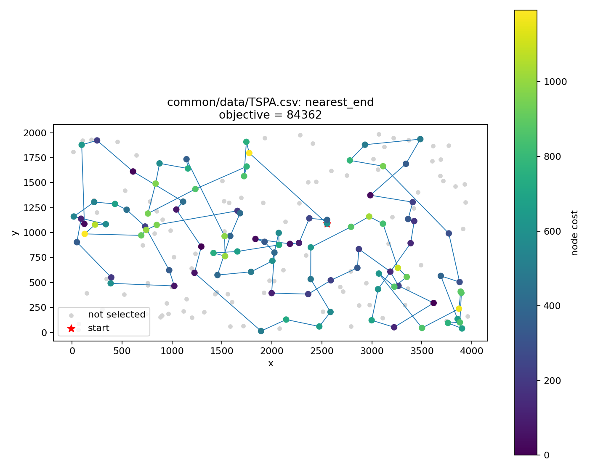
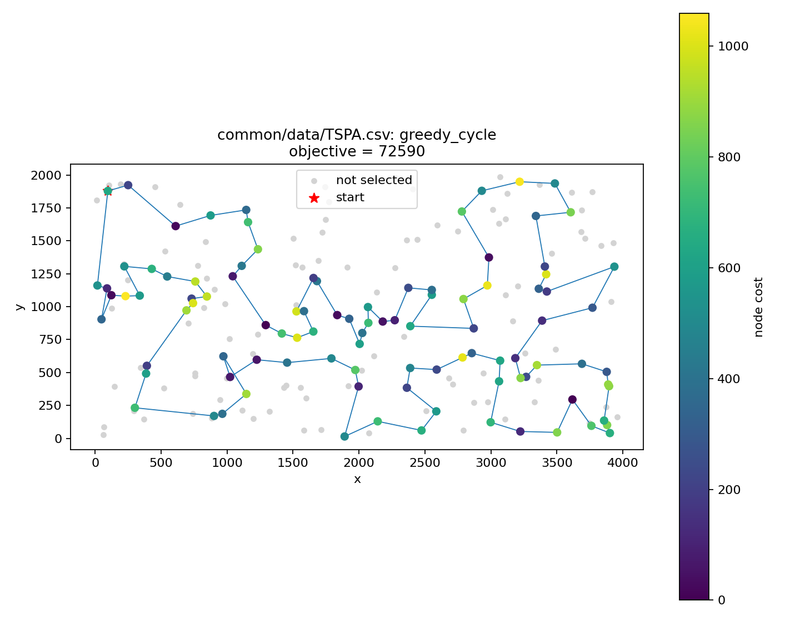
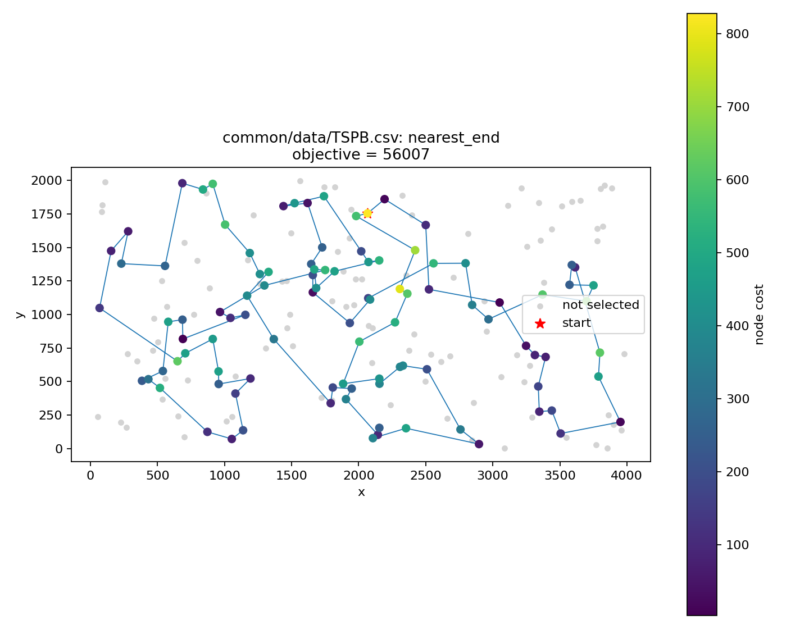
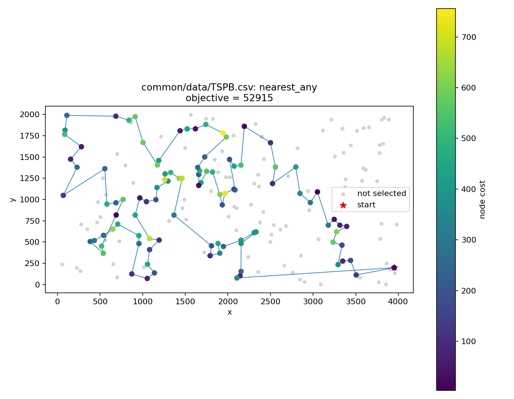
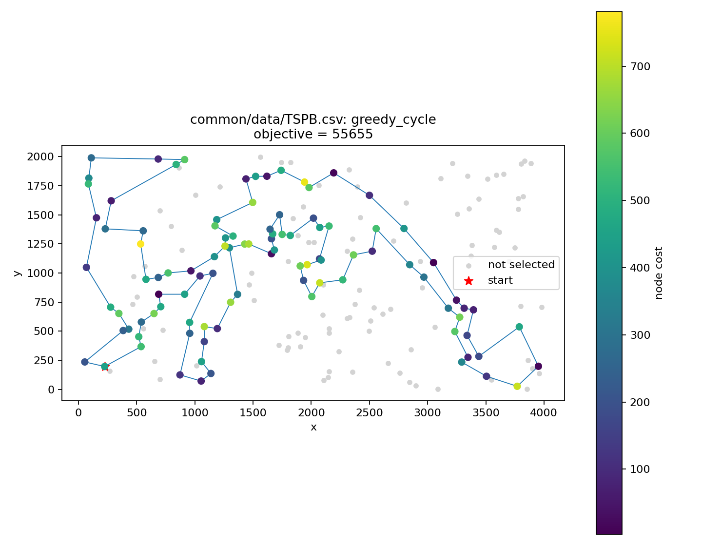

# Lab 1: Greedy heuristics

Authors: Piotr Foltyniewicz 160295, Jakub Adamski 160291

## Problem description

Each instance consists of 200 nodes. A row in the input file contains the node's planar coordinates and selection cost, in the form `x;y;cost`. Node indices are zero-based and correspond to row order. The task is to select exactly 100 distinct nodes (half of the available nodes), order them, and form a closed cycle that minimizes the sum of travel distances and selected-node costs.

Distances are Euclidean, rounded to the nearest integer and precomputed after reading the instance. All algorithms use this distance matrix. The evaluation sums all selected-node costs and all cycle edges, including last -> first. In the pseudocode, `m = 100`, `c[v]` is node cost, and `d(a, b)` is the precomputed distance.

The objective for an ordered selection `S` is:

```text
F(S) = sum(c[S[i]]) + sum(d(S[i], S[(i + 1) mod length(S)]))
```

## Pseudocode

All indices are zero-based. Inserting at index `length(S)` appends a node. The unused set `U` is represented by a boolean array. Each algorithm returns its selected sequence and its closed-cycle objective.

### Random solution

```text
RANDOM(V, m):
    P = random shuffle of V
    S = first m elements of P
    return S, evaluateClosedCycle(S)
```

### Nearest neighbor: append at the end

Available nodes are tracked in a fixed-size boolean array. Candidates are scanned by increasing index; ties keep the first candidate.

```text
NEAREST_END(start):
    S = [start]
    U = V minus {start}
    while length(S) < m:
        v = argmin over U of (d(last(S), v) + c[v])
        append v to S
        remove v from U
    return S, evaluateClosedCycle(S)
```

### Nearest neighbor: insertion at any position

Every unused node is tested at the beginning, at the end, and between every consecutive pair of selected nodes. The closing edge is excluded from insertion decisions. For an internal position, the old edge is replaced by two edges and the new node cost is added.

```text
NEAREST_ANY(start):
    S = [start]
    U = V minus {start}
    while length(S) < m:
        bestDelta = infinity
        for position = 0, ..., length(S):
            for v in U in increasing index order:
                delta = c[v]
                if position > 0:
                    delta += d(S[position - 1], v)
                if position < length(S):
                    delta += d(v, S[position])
                if 0 < position < length(S):
                    delta -= d(S[position - 1], S[position])
                if delta < bestDelta:
                    bestDelta = delta
                    bestNode = v
                    bestPosition = position
        insert bestNode into S at index bestPosition
        remove bestNode from U
    return S, evaluateClosedCycle(S)
```

### Greedy cycle

The same exhaustive insertion search is applied to a closed cycle, including the last-to-first edge. A single starting node forms a self-edge; consequently the first insertion costs `2 * d(start, v) + c[v]`. Neither NN2 nor greedy cycle uses a cache. Both scan positions first, then node indices; strict `<` keeps the first pair in a tie.

```text
GREEDY_CYCLE(start):
    S = [start]
    U = V minus {start}
    while length(S) < m:
        bestDelta = infinity
        for position = 1, ..., length(S):
            for v in U in increasing index order:
                left = S[position - 1]
                right = S[position mod length(S)]
                delta = d(left, v) + d(v, right) - d(left, right) + c[v]
                if delta < bestDelta:
                    bestDelta = delta
                    bestNode = v
                    bestPosition = position
        insert bestNode into S at index bestPosition
        remove bestNode from U
    return S, evaluateClosedCycle(S)
```

## Results

Each method was tested 200 times on TSPA and TSPB; greedy methods started once from each node.

| Instance | Method | Runs | Minimum | Maximum | Mean | Avg Time (ms) |
|---|---|---:|---:|---:|---:|---:|
| TSPA | Random solution | 200 | 240638 | 297299 | 262473.29 | 0.003277 |
| TSPA | Nearest neighbor: end | 200 | 84362 | 90075 | 87476.63 | 0.016166 |
| TSPA | Nearest neighbor: any | 200 | 72328 | 77022 | 74306.53 | 0.820964 |
| TSPA | Greedy cycle | 200 | 72590 | 75281 | 73743.73 | 1.206994 |
| TSPB | Random solution | 200 | 179002 | 237917 | 206980.05 | 0.003033 |
| TSPB | Nearest neighbor: end | 200 | 56007 | 63166 | 59397.34 | 0.014959 |
| TSPB | Nearest neighbor: any | 200 | 52915 | 66164 | 59476.23 | 0.820473 |
| TSPB | Greedy cycle | 200 | 55655 | 63734 | 59650.81 | 1.206786 |

## Best solutions and visualizations

Node color represents selection cost. Gray nodes are not selected, blue segments form the closed tour, and the red star marks the first node in the displayed sequence. This may differ from the construction start when insertion before the first node is allowed. Lists below use one node index per line.

### TSPA

#### Random solution

Objective: **240638**. Run: `56`. Construction start: `not applicable`.


<details>
<summary>Solution</summary>

```text
12
27
177
66
114
86
25
112
120
47
80
161
95
132
19
115
58
184
140
42
154
193
158
67
172
125
133
48
98
39
103
54
51
149
129
41
156
85
57
15
163
153
87
45
143
185
28
14
49
111
99
8
9
173
23
91
174
1
165
40
197
52
118
83
107
43
136
108
5
31
157
171
4
96
146
182
176
78
50
70
71
155
152
196
79
102
191
105
106
117
116
44
60
141
188
59
199
123
53
20
```

</details>

#### Nearest neighbor: end

Objective: **84362**. Run: `54`. Construction start: `54`.



<details>
<summary>Solution</summary>

```text
54
9
33
36
177
67
144
53
135
58
134
176
174
106
89
107
57
182
151
93
50
3
1
164
178
29
136
186
184
47
159
130
153
78
88
193
170
146
75
64
150
42
113
43
85
142
8
131
84
158
192
181
114
141
180
132
76
80
48
31
63
149
168
97
127
187
30
123
152
108
60
116
49
11
119
160
83
90
51
16
35
87
45
140
52
179
185
28
102
156
157
71
91
38
100
4
112
139
115
5
```

</details>

#### Nearest neighbor: any

Objective: **72328**. Run: `11`. Construction start: `11`.


<details>
<summary>Solution</summary>

```text
104
129
69
127
97
168
116
149
63
11
49
160
83
123
100
152
108
60
31
48
80
91
157
71
4
76
132
180
28
102
185
35
156
51
16
67
144
140
53
179
52
177
36
33
9
54
131
174
8
164
186
136
163
29
101
178
1
169
3
50
147
47
93
106
42
89
113
130
159
146
170
153
193
78
88
107
64
57
182
151
150
176
72
134
84
58
158
192
181
114
135
73
45
87
141
187
30
189
2
171
```

</details>

#### Greedy cycle

Objective: **72590**. Run: `31`. Construction start: `31`.



<details>
<summary>Solution</summary>

```text
31
116
149
168
63
11
49
60
108
152
100
90
123
83
160
97
127
69
171
2
189
30
187
141
87
45
73
135
114
181
192
158
58
84
134
72
176
150
151
182
57
64
107
88
78
193
153
170
146
159
130
113
89
42
106
93
47
147
50
3
169
1
178
101
29
163
136
186
164
142
8
174
131
54
9
33
36
177
52
179
53
140
144
67
16
51
156
35
185
102
28
180
132
76
4
71
157
91
80
48
```

</details>

### TSPB

#### Random solution

Objective: **179002**. Run: `190`. Construction start: `not applicable`.


<details>
<summary>Solution</summary>

```text
101
95
47
64
126
33
76
173
44
92
155
69
137
146
43
34
141
56
20
66
12
168
195
85
171
148
105
131
196
179
130
167
128
19
54
187
193
36
159
184
79
89
199
94
98
165
52
120
93
185
111
11
176
40
180
145
58
172
197
28
140
4
162
32
181
90
117
50
72
122
17
38
106
102
113
39
55
70
103
170
154
153
119
160
144
9
129
127
10
7
59
149
86
14
80
46
183
81
150
109
```

</details>

#### Nearest neighbor: end

Objective: **56007**. Run: `32`. Construction start: `32`.



<details>
<summary>Solution</summary>

```text
32
89
57
76
54
127
129
90
153
20
14
2
110
118
56
114
196
10
148
143
78
192
162
104
185
184
3
151
69
172
133
120
96
121
198
48
72
46
86
117
160
136
8
21
154
140
47
170
125
177
6
132
29
197
175
134
45
60
40
71
155
97
115
180
65
28
149
145
158
116
147
42
50
130
30
183
38
64
85
59
167
51
87
179
82
88
171
99
67
24
34
181
152
73
98
27
135
75
79
156
```

</details>

#### Nearest neighbor: any

Objective: **52915**. Run: `50`. Construction start: `50`.



<details>
<summary>Solution</summary>

```text
110
2
14
20
74
153
182
52
90
129
127
80
54
192
162
104
76
185
57
89
86
46
72
3
184
173
151
122
117
8
160
69
172
136
133
120
156
43
48
96
198
121
130
191
50
42
147
116
37
146
13
149
28
145
65
158
177
125
26
170
197
36
132
29
6
180
115
155
71
175
134
45
157
60
40
141
97
154
140
47
38
21
176
30
183
189
168
64
59
85
51
73
167
152
34
24
181
179
87
82
```

</details>

#### Greedy cycle

Objective: **55655**. Run: `174`. Construction start: `174`.



<details>
<summary>Solution</summary>

```text
174
36
197
6
180
115
170
97
140
47
155
71
175
134
45
157
60
141
40
33
64
21
189
168
69
160
172
136
133
120
8
117
72
46
86
184
3
173
122
151
98
111
27
135
76
185
162
192
80
52
182
20
74
2
93
110
118
14
153
90
129
127
54
104
57
89
156
43
48
96
198
121
63
130
191
183
30
176
38
154
26
125
177
138
158
145
149
147
42
116
37
146
13
28
65
178
103
29
132
1
```

</details>

## Solution checking

All 1600 exported solutions were checked for exactly 100 distinct indices in the range 0-199. Their objectives were independently recalculated from the input coordinates using rounded Euclidean distances, including the closing edge and each selected node cost exactly once. The recalculated objectives match the exported values. Current solutions have not been rechecked with the provided Excel checker; the earlier Excel checks concerned previous versions.

## Source code

Repository: [PiotrFoltyniewicz/Evolutionary-Computation](https://github.com/PiotrFoltyniewicz/Evolutionary-Computation).

- [Greedy algorithms](../src/greedy_methods.cpp)
- [Random solution](../../common/src/random_solution.cpp)
- [Objective evaluation](../../common/src/types.hpp)
- [Experiment statistics and timing](../../common/src/experiment.cpp)
- [Experiment runner](../src/lab1_experiment.cpp)
- [Visualization script](../src/visualize_experiments.py)
- [Exported solutions](generated/greedy_results.csv)

## Conclusions

All greedy methods substantially improve on random selection and ordering. Allowing insertion at every position produces a lower mean objective than appending only at the end on both instances.

On TSPA, greedy cycle has the lowest mean (73743.73), while NN2 finds the best individual solution (72328). On TSPB, NN2 has both the lowest mean (59476.23) and the best individual solution (52915). Accounting for the closing edge during construction therefore does not guarantee a better final result.

NN1 is the fastest greedy method in this experiment. NN2 and greedy cycle exhaustively test node-position pairs at every step, trading additional running time for improved solution quality. Both implementations are deliberately written without a cache.
