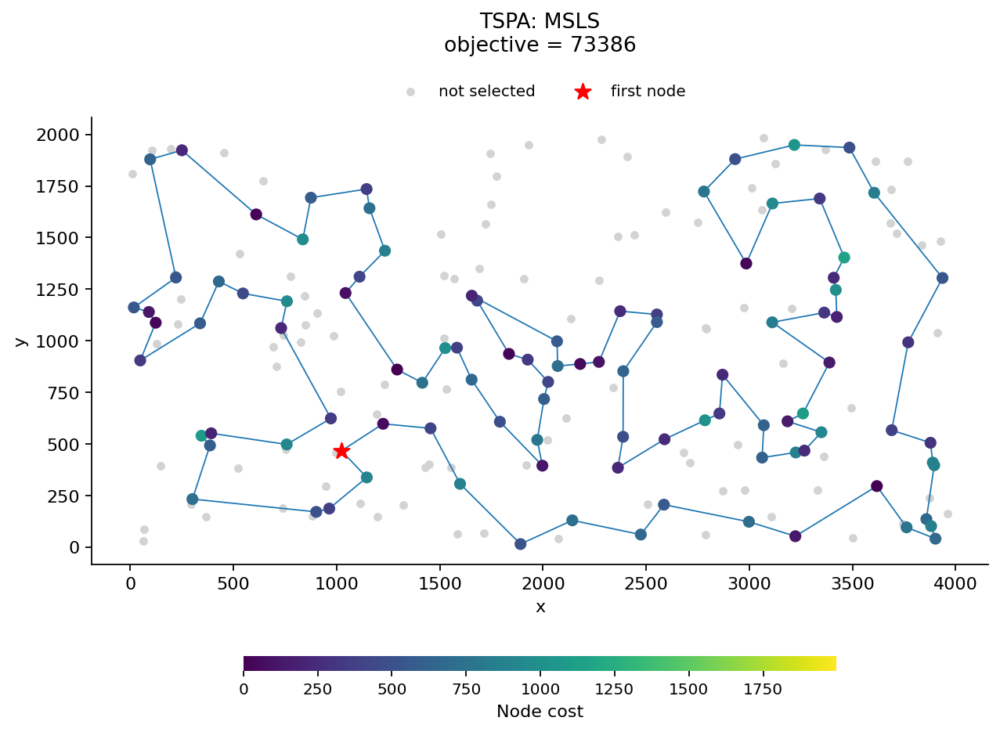
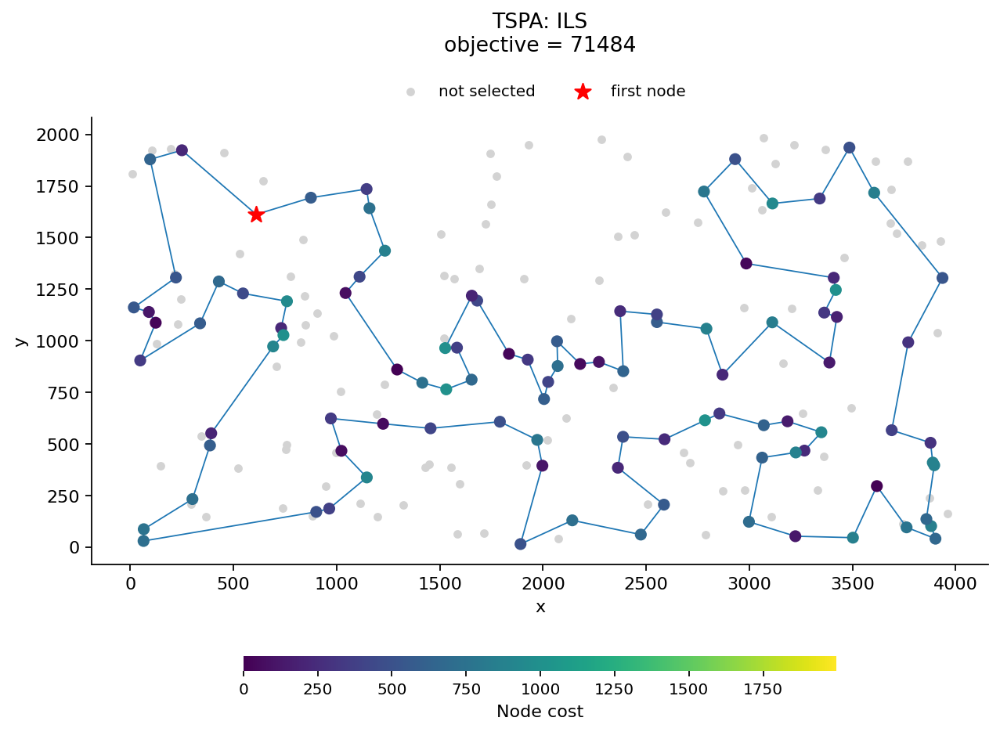
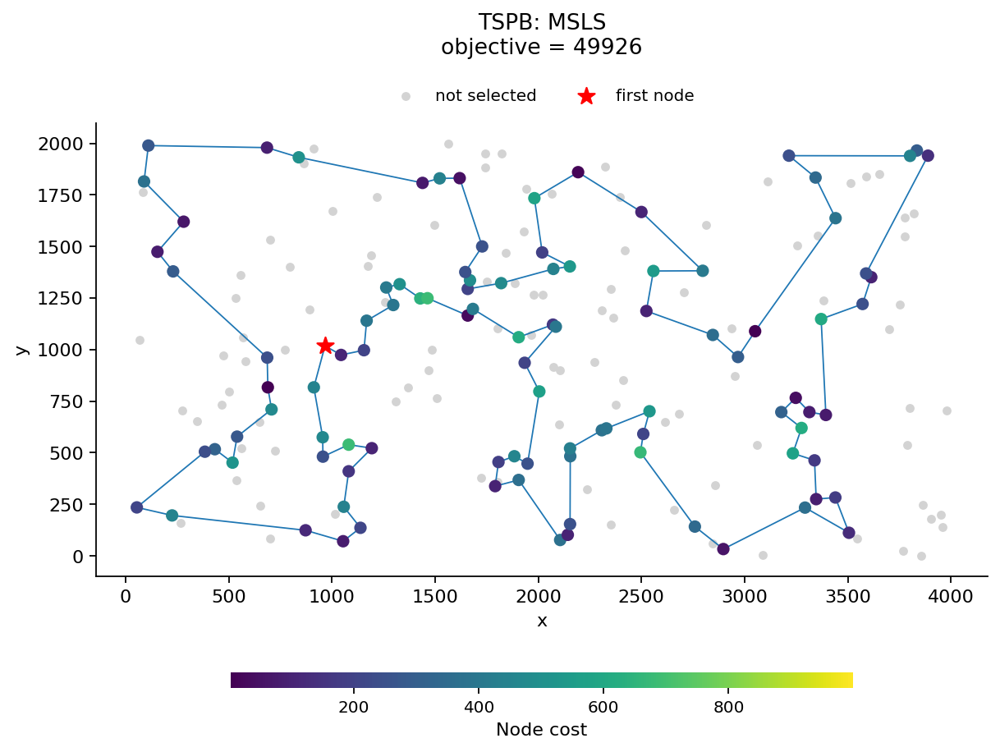
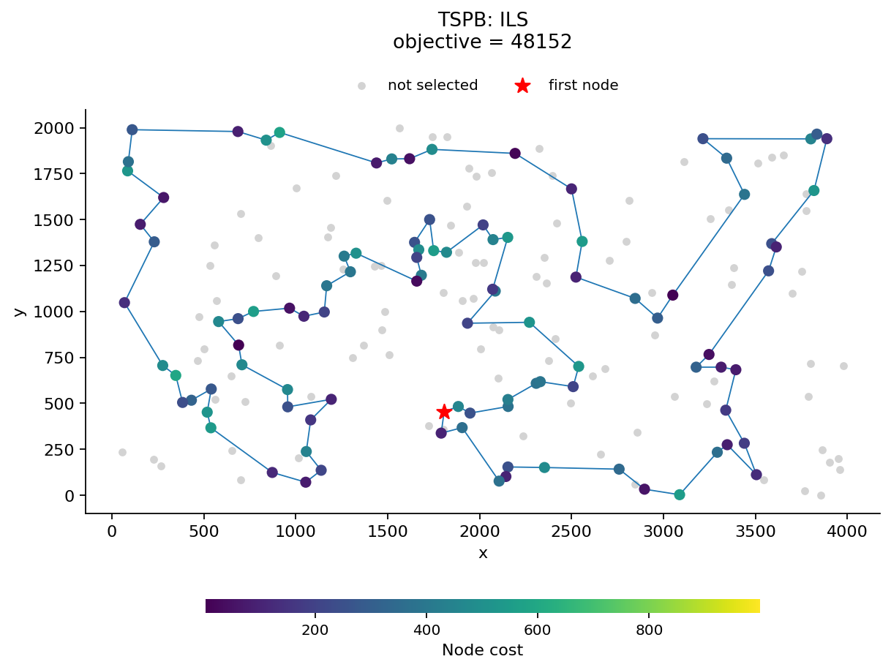

# Lab 6: Multiple start and iterated local search

Authors: Piotr Foltyniewicz 160295, Jakub Adamski 160291

## Problem description

Select 100 distinct nodes from 200 and arrange them in a closed cycle. Minimize the sum of selected-node costs and rounded Euclidean edge lengths, including the closing edge. Node IDs are zero-based row indices in the input files.

```text
F(S) = sum(cost[S[i]] + dist(S[i], S[(i+1) mod 100]), i=0..99)
```

## Pseudocode

### Move-list local search from lab 5

We use the move-list LS from lab 5. Here `n=200`, `m=100`, and indices around the cycle use modulo m. `pos[v]` is the position of node v, or -1 if it is unselected. A saved move contains `(delta,type,a,b,c,d)` using node IDs:

- `INTER`: replace b by unselected d, keeping its neighbors a,c.
- `EDGES`: remove (a,b),(c,d), add (a,c),(b,d), and reverse the segment between the cuts.

LM is a min-priority queue ordered by `(delta,type,a,b,c,d)`, with INTER before EDGES. `HEAPIFY` builds this queue from a list. Slices `S[l:r]` include l and exclude r; `+` joins lists. Functions `APPLY` and `LS` modify S in place. `LS` returns the final objective value.

### Create the move list

Evaluate every replacement and both descriptors of each nonadjacent edge pair. Store only descriptors with negative delta. The second edge descriptor starts with its edges in opposite directions; it is kept for a possible later reversal.

```text
POSITIONS(S):
    pos[0..n-1] = -1
    for i = 0..m-1:
        pos[S[i]] = i
    return pos

GENERATE(S, pos):
    moves = []
    for i = 0..m-1:
        a = S[(i-1) mod m]; b = S[i]; c = S[(i+1) mod m]
        for d = 0..n-1 where pos[d] == -1:
            delta = dist(a,d) + dist(d,c) - dist(a,b) - dist(b,c)
                    + cost[d] - cost[b]
            if delta < 0:
                append (delta, INTER, a,b,c,d) to moves
    for i = 0..m-1:
        for j = i+2..m-1:
            if i == 0 and j == m-1: continue
            a = S[i]; b = S[(i+1) mod m]
            c = S[j]; d = S[(j+1) mod m]
            removed = dist(a,b) + dist(c,d)
            delta = dist(a,c) + dist(b,d) - removed
            if delta < 0:
                append (delta, EDGES, a,b,c,d) to moves
            delta = dist(a,d) + dist(b,c) - removed
            if delta < 0:
                append (delta, EDGES, a,b,d,c) to moves
    return moves
```

### Check and select saved moves

Invalid moves are removed. A move whose two edges currently have opposite directions is deferred. The queue returns the lowest-delta applicable saved move.

```text
EDGE_DIRECTION(S, pos, a, b):
    if pos[a] == -1 or pos[b] == -1: return MISSING
    if S[(pos[a]+1) mod m] == b: return FORWARD
    if S[(pos[b]+1) mod m] == a: return REVERSED
    return MISSING

STATUS(S, pos, move):
    (_, type, a,b,c,d) = move
    if type == INTER:
        if pos[d] != -1 or pos[b] == -1: return INVALID
        if EDGE_DIRECTION(S,pos,a,b) == MISSING: return INVALID
        if EDGE_DIRECTION(S,pos,b,c) == MISSING: return INVALID
        return APPLICABLE
    first = EDGE_DIRECTION(S,pos,a,b)
    second = EDGE_DIRECTION(S,pos,c,d)
    if first == MISSING or second == MISSING: return INVALID
    if first == second: return APPLICABLE
    return DEFERRED

TAKE_APPLICABLE(LM, S, pos):
    deferred = []; chosen = NONE
    while LM is not empty:
        move = pop minimum from LM
        status = STATUS(S,pos,move)
        if status == APPLICABLE:
            chosen = move
            break
        if status == DEFERRED:
            append move to deferred
        // INVALID moves are discarded
    reinsert every move from deferred into LM
    return chosen
```

### Apply a move and run LS

After each move, update the objective and positions. Rebuild LM when no saved move applies. Stop when a freshly rebuilt queue also has no applicable improving move.

```text
APPLY(S, pos, move):
    (_, type, a,b,c,d) = move
    if type == INTER:
        S[pos[b]] = d
    else:
        forward = EDGE_DIRECTION(S,pos,a,b) == FORWARD
        i = pos[a] if forward else pos[b]
        j = pos[c] if forward else pos[d]
        if i > j: swap(i,j)
        reverse S[i+1:j+1]
```

```text
LS(S):
    value = F(S)
    pos = POSITIONS(S)
    LM = HEAPIFY(GENERATE(S,pos))
    loop:
        move = TAKE_APPLICABLE(LM,S,pos)
        if move == NONE:
            LM = HEAPIFY(GENERATE(S,pos))
            move = TAKE_APPLICABLE(LM,S,pos)
            if move == NONE:
                return value
        APPLY(S,pos,move)
        value += move.delta
        pos = POSITIONS(S)
```

`COPY` makes a separate copy, `SHUFFLE` randomly reorders a list in place using rng, and `NOW()` returns monotonic time in milliseconds.

### Multiple start local search (MSLS)

One MSLS run generates 400 random solutions, improves each with LS, and returns the best one.

```text
RANDOM_SOLUTION(rng):
    S = [0,1,...,199]
    SHUFFLE(S, rng)
    return S[0:100]

MSLS(rng):
    t0 = NOW()
    best = NONE; bestValue = infinity; calls = 0
    repeat 400 times:
        candidate = RANDOM_SOLUTION(rng)
        value = LS(candidate)
        calls += 1
        if value < bestValue:
            best = COPY(candidate)
            bestValue = value
    elapsed = NOW() - t0
    return best, bestValue, calls, elapsed
```

### ILS perturbation

The perturbation modifies a copy of the best solution in two steps:

1. Replace r randomly chosen nodes with r distinct nodes from outside the solution. Start with r=2. After 50, 100 and 150 consecutive attempts without improvement, increase r to 4, 6 and 8 respectively. A strict improvement resets r to 2.

2. Split the solution into four random segments A, B, C, D, each containing at least two nodes, and join them as A, D, C, B. Keep the order of nodes inside each segment. This is the double bridge move.

Each solution is a cycle: the last node connects back to the first. Choose a random node as the first item, keeping the same cyclic order. For example:

```text
0 -> 1 -> 2 -> 3 -> 0
2 -> 3 -> 0 -> 1 -> 2
```

Both lists have the same edges and cost. The edge between the new last and first nodes is one cut. Choose three more cuts inside the list to create four segments. If any segment has fewer than two nodes, redraw the three internal cuts.

Here q counts consecutive ILS attempts without a strictly better result after LS. The incoming nodes are chosen from outside S before any replacements. `PERTURB` modifies S in place.

```text
PERTURB(S, q, rng):
    r = 2 + 2*min(floor(q/50), 3)
    U = [v in 0..199 such that v is not in S]
    P = [0,1,...,99]
    SHUFFLE(P, rng)
    SHUFFLE(U, rng)
    for i = 0..r-1:
        S[P[i]] = U[i]

    k = uniform random integer from 0..99 using rng
    S = S[k:100] + S[0:k]
    cuts = [1,2,...,99]
    repeat:
        SHUFFLE(cuts, rng)
        (a,b,c) = SORT(cuts[0:3])
    until min(a, b-a, c-b, 100-c) >= 2
    A = S[0:a]; B = S[a:b]; C = S[b:c]; D = S[c:100]
    S = A + D + C + B
```

### Iterated local search (ILS)

Start from one random solution and improve it with LS. Then repeatedly perturb a copy of the best solution and run LS again. Keep the candidate only when its objective is lower. Otherwise keep the previous best solution and increase q; an equal objective also counts as failure.

```text
ILS(rng, T):
    t0 = NOW(); deadline = t0 + T
    best = RANDOM_SOLUTION(rng)
    bestValue = LS(best)
    calls = 1; q = 0
    while NOW() < deadline:
        candidate = COPY(best)
        PERTURB(candidate, q, rng)
        if NOW() >= deadline:
            break
        value = LS(candidate)
        calls += 1
        if value < bestValue:
            best = COPY(candidate)
            bestValue = value
            q = 0
        else:
            q += 1
    elapsed = NOW() - t0
    return best, bestValue, calls, elapsed
```

### Computational experiment

For each instance, run MSLS 20 times. Set the ILS limit T to the mean total time of these 20 MSLS runs, then run ILS 20 times with that limit. The first LS in ILS is included in both the timer and the LS count. A started LS always finishes, so the final call may slightly exceed T.

The timer includes random solution generation, perturbation and local search. Data loading, distance preprocessing, generator initialization and writing results are outside it. Each run uses a separate `mt19937` generator with seed `20261114 + 1000*instanceIndex + run`, where TSPA has index 0, TSPB index 1, and run is 0..19. The matching MSLS and ILS runs therefore begin with the same random solution. Compilation: `g++ -std=c++20 -O2`.

## Results

Tables show **mean (minimum - maximum)**. MSLS and ILS use 20 runs per instance. The comparison includes the best construction heuristics and local search variants from earlier labs, with their original 200-run results. Earlier timings were measured separately.


### Objective function values

| Method | TSPA | TSPB |
|---|---:|---:|
| **MSLS (lab 6)** | 73608.50 (73386 - 74027) | 50296.75 (49926 - 50760) |
| **ILS (lab 6)** | 71663.85 (71484 - 71994) | 48323.80 (48152 - 48477) |
| Steepest Edges Random (lab 5) | 76282.22 (73825 - 80885) | 52617.19 (50056 - 55057) |
| Move List Edges Random (lab 5) | 76245.98 (73815 - 80002) | 52471.51 (50420 - 55821) |
| Candidate Edges k20 Random (lab 4) | 76095.42 (73288 - 80182) | 52675.29 (49459 - 55512) |
| Candidate Edges k10 Random (lab 4) | 76278.36 (73966 - 79184) | 52640.37 (50362 - 56836) |
| Steepest Edges Greedy (lab 3) | 73003.80 (71955 - 74861) | 53091.28 (49346 - 60354) |
| Greedy Edges Greedy (lab 3) | 72978.63 (71955 - 74861) | 53183.11 (49938 - 60266) |
| NN heuristics with a weighted sum criterion (lab 2) | 75561.20 (72419 - 78504) | 55698.34 (50485 - 61406) |
| Greedy Cycle heuristics with a weighted sum criterion (lab 2) | 73353.51 (72011 - 75532) | 57866.33 (52731 - 63370) |

### Running times (ms per complete run)

| Method | TSPA | TSPB |
|---|---:|---:|
| **MSLS (lab 6)** | 511.498428 | 509.700618 |
| **ILS (lab 6)** | 511.624135 | 509.816645 |
| Steepest Edges Random (lab 5) | 34.347375 | 33.977279 |
| Move List Edges Random (lab 5) | 2.986067 | 2.997350 |
| Candidate Edges k20 Random (lab 4) | 14.623206 | 12.190080 |
| Candidate Edges k10 Random (lab 4) | 7.959120 | 6.762205 |
| Steepest Edges Greedy (lab 3) | 4.783631 | 7.824274 |
| Greedy Edges Greedy (lab 3) | 5.153959 | 7.519259 |
| NN heuristics with a weighted sum criterion (lab 2) | 4.463945 | 4.085049 |
| Greedy Cycle heuristics with a weighted sum criterion (lab 2) | 3.936194 | 3.930922 |

### Number of complete basic LS runs

The initial LS is included. Values are mean (minimum - maximum) across 20 runs. MSLS performs exactly 400 calls in each run.

| Method | TSPA | TSPB |
|---|---:|---:|
| MSLS | 400.00 (400 - 400) | 400.00 (400 - 400) |
| ILS | 2076.05 (1948 - 2177) | 2173.35 (2089 - 2292) |

## Best solutions and visualizations

Node IDs are read left to right, then top to bottom. The last node connects back to the first. Colors show selection costs; gray nodes are unselected and the red star marks the first listed node.

### TSPA

#### MSLS

Objective: **73386**, run **7** (zero-based).



**Solution (node order):**

```text
187 189   2 171  69 127  95  97 161  30
123 100 152 108  49 168  63 149 116  60
 31  48  80  38  91 157  71   4  76 132
180  28 156  35 185  45 135  73 140  53
144  67  16  51  52 179 177  36  33   9
 54 131  84  58 134  72 176 174 150 151
 42  89 113 106  43  93  85   3  50 169
  1  59 178 184 164 186 136 163  29 101
147  47 130 159 146 170 153 193  78  88
107  57 182 158 192 181 114  98  87 141
```

#### ILS

Objective: **71484**, run **18** (zero-based).



**Solution (node order):**

```text
 80  48  31  60 116 149  63 168  49 108
152 100 123  83 160  97 127  69 129 104
171   2 189 187  30 141  87  45  73 135
114 181 192 158  58  84 134  72 176 150
106 113  89  42 151 182  57  64 107  88
 78 193 153 170 146 159 130  47 147 101
 29 178 184 136 186 164   1 169   3  50
 93  85 174   8  54   9  33 131  36 177
 52 179  53 140 144  67  16  51 156  35
185 102  28 180 132  76   4  71 157  91
```

### TSPB

#### MSLS

Objective: **49926**, run **4** (zero-based).



**Solution (node order):**

```text
154 140  47  38  21  30 183 189 168  69
160 122 184   3 151  98 167  73  59  85
 51  82  87 179 181 152  34  24  66  67
 31  99 171  74   2  14  20 153 182  52
 80 127 129  90  78  10 114 196 105  94
 81 190  70 187  54 192 162  76 185 104
 57  89 156  72  86  46 117 172 136 133
120  96 198 121 147 116  37 146 149  28
145 125 170 115   6 197  29 132   1 174
175 134  45 157  60  40 141  71 155  97
```

#### ILS

Objective: **48152**, run **10** (zero-based).



**Solution (node order):**

```text
 59  73 167 181 152  34  24  67  66  27
151   3 184  86  46  72 117   8 120 133
136 172 160  69 183  30  21  38  47 140
154  26 125 177 170 115 155  71  40  60
157  45 134 175  36 197   6  29 132 103
178  65 145  28 149  13 146  37 116 147
 42 121 198  96  48  89  57 185  76 162
192  54 187  70 190  81  94 105  61 196
114  10 127  80 129  90 153  14   2  20
 74  17 171  99  88 179  87  82  51  85
```

## Solution checking

All 80 exported cycles contain 100 distinct valid node IDs. Recomputed objectives and summary statistics match the CSV records. The four plotted solutions attain the reported minima.

## Source code

- [MSLS, ILS and perturbation](../src/metaheuristics.cpp)
- [Experiment runner](../src/lab6_experiment.cpp)
- [Reused move-list LS](../../lab5/src/move_list_search.cpp)
- [Validation, plots and report generator](../src/create_report.py)
- [All 80 runs, timings, seeds and LS counts](generated/results.csv)
- [Summary](generated/summary.csv)
- [Best solutions](generated/best_solutions.csv)
- [Lab 5 report](../../lab5/out/report.md)
- [Lab 4 report](../../lab4/out/report.md)

## Conclusions

On TSPA, ILS reduces the mean objective from 73608.50 to 71663.85 (2.642% improvement). Its best value is 71484, versus 73386 for MSLS. It beats MSLS in 20/20 matching-seed comparisons and improves on the best earlier LS mean of 72978.63.

On TSPB, ILS reduces the mean objective from 50296.75 to 48323.80 (3.923% improvement). Its best value is 48152, versus 49926 for MSLS. It beats MSLS in 20/20 matching-seed comparisons and improves on the best earlier LS mean of 52471.51.

ILS achieves better results on both instances within the MSLS time budgets. It preserves most of a good solution between searches, allowing more LS calls than fully random restarts: about 2,000 per run, compared with 400 for MSLS.
