# Lab 8 - Global convexity

Authors - Piotr Foltyniewicz 160295, Jakub Adamski 160291

## Problem description

Select 100 distinct nodes from 200 and arrange them in a closed cycle. Minimize selected-node costs plus rounded Euclidean edge lengths, including the closing edge.

For each instance, generate 1000 random solutions and apply greedy local search from lab 3. The neighborhood consists of selected-node replacements and edge exchanges (2-opt). Apply the first improving move in random order until no improving move remains.

## Pseudocode

Edges are undirected and include the closing edge. The average compares each run with the other 999 runs. For a single reference, any occurrence of its cycle is excluded from both charts. Reversing or rotating the cycle leaves its edge set unchanged.

```text
for each instance:
    optima = 1000 runs of GREEDY_LS(RANDOM_SOLUTION())
    best = first optimum with the lowest objective
    ils = best ILS cycle from lab 6
    for each optimum S in optima:
        for each measure in [common edges, common selected nodes]:
            average = sum(COMMON(S, T) for the other 999 runs) / 999
            save (F(S), average) for the average similarity chart
            for each reference in [best, ils]:
                if S and reference have different edge sets:
                    save (F(S), COMMON(S, reference)) for its chart
    calculate Pearson's r for the points in each chart
```

## Results

### Objective function values

| Reference | TSPA | TSPB |
| --- | --- | --- |
| Best of 1000 local optima | 73329 | 49988 |
| ILS (lab 6) | 71514 | 48152 |

### Pearson correlation coefficients

| Comparison | Measure | TSPA | TSPB |
| --- | --- | --- | --- |
| Average similarity | Common edges | -0.622 | -0.637 |
| Average similarity | Common selected nodes | -0.423 | -0.458 |
| Similarity to the best of 1000 | Common edges | -0.556 | -0.486 |
| Similarity to the best of 1000 | Common selected nodes | -0.625 | -0.527 |
| Similarity to ILS (lab 6) | Common edges | -0.608 | -0.604 |
| Similarity to ILS (lab 6) | Common selected nodes | -0.687 | -0.673 |

## Visualizations

### TSPA

#### Average similarity

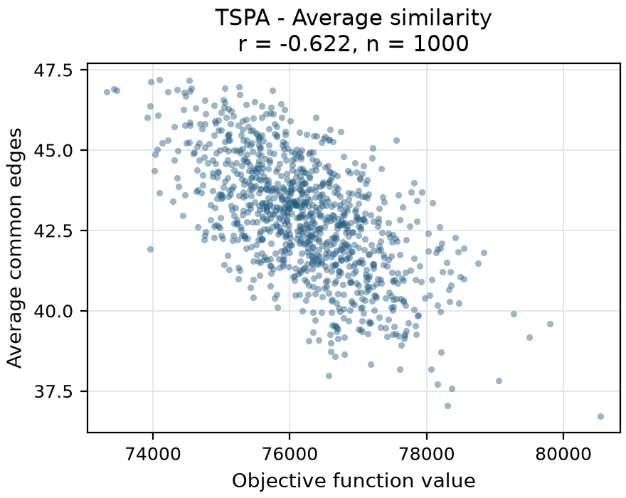

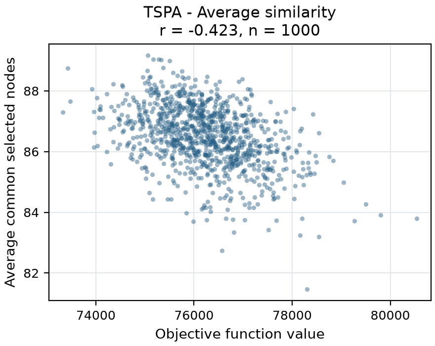

#### Similarity to the best of 1000

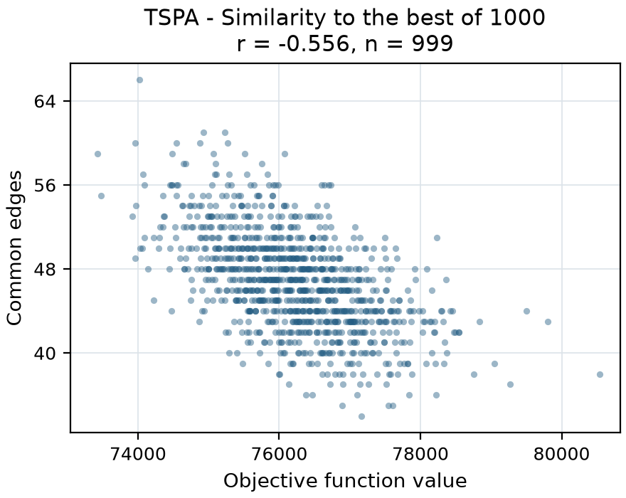

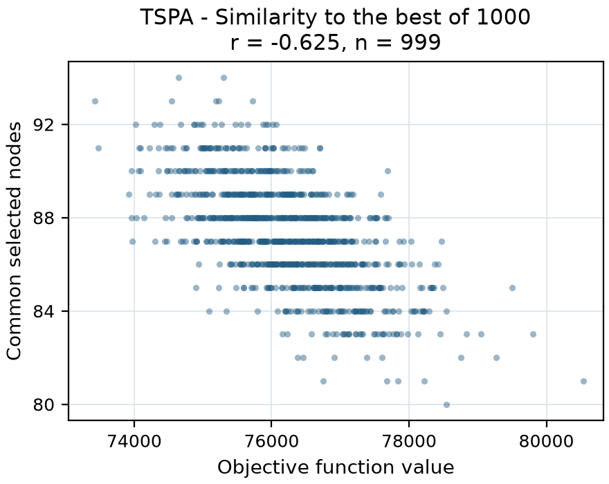

#### Similarity to ILS (lab 6)

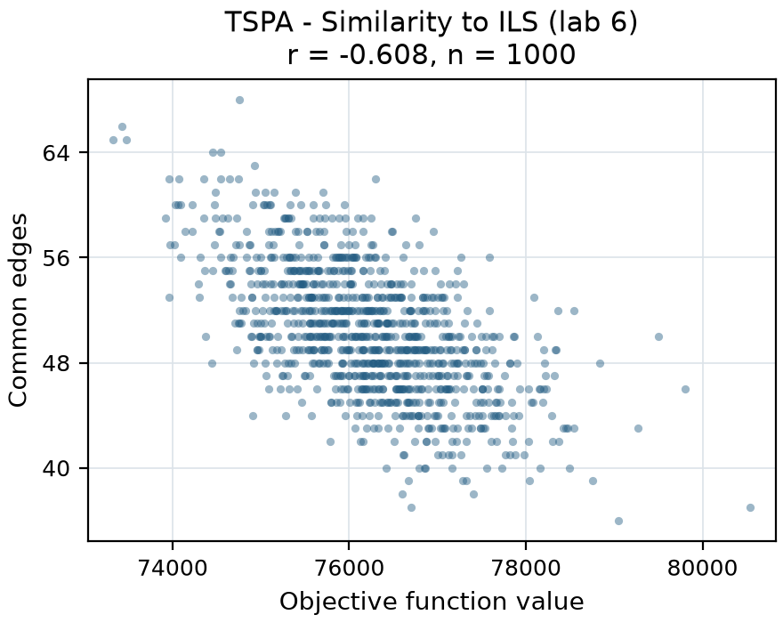

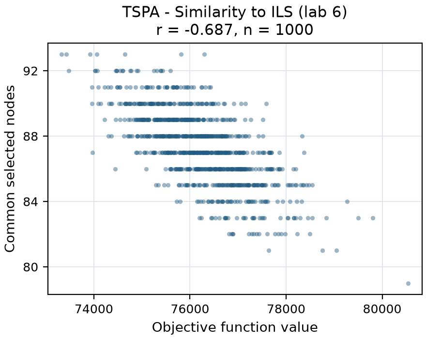

### TSPB

#### Average similarity

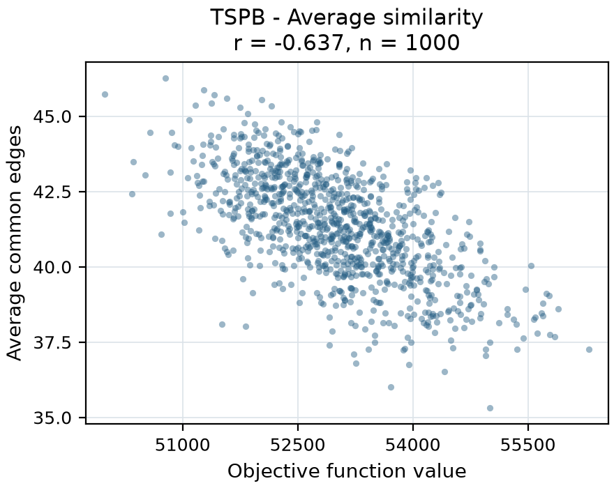

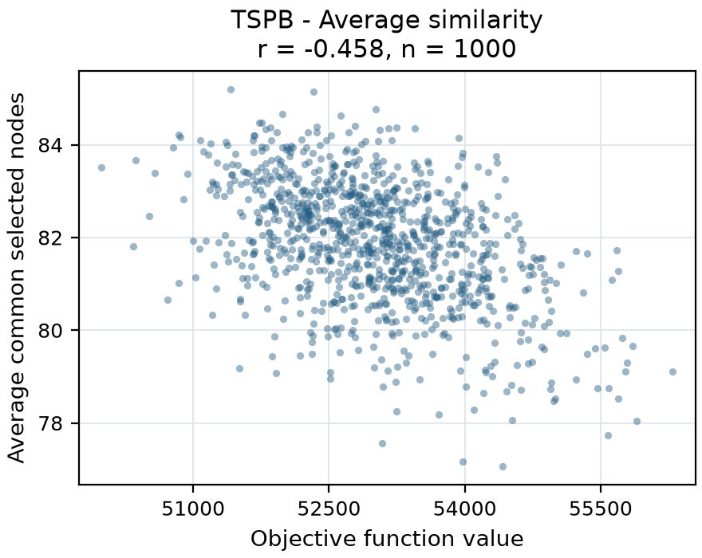

#### Similarity to the best of 1000

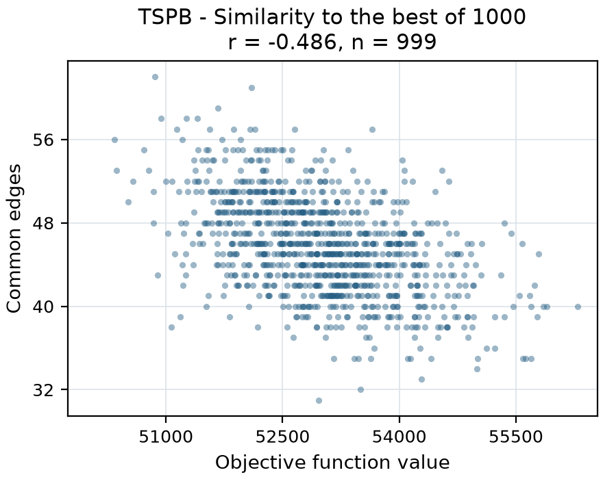

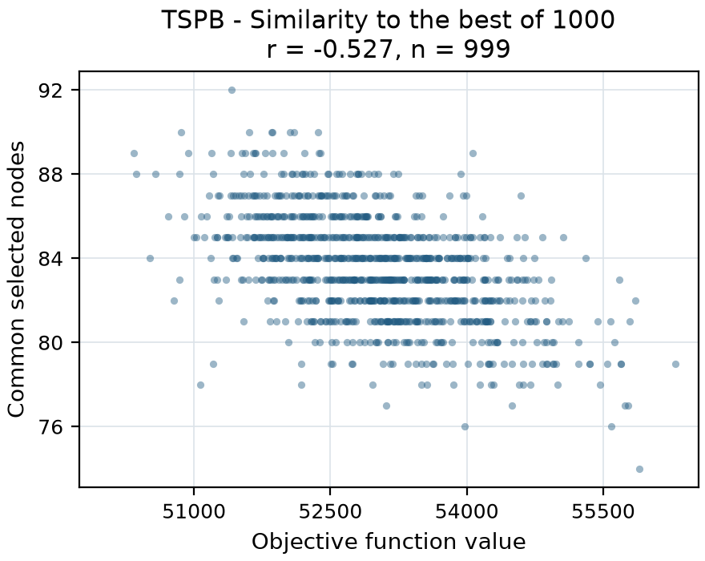

#### Similarity to ILS (lab 6)

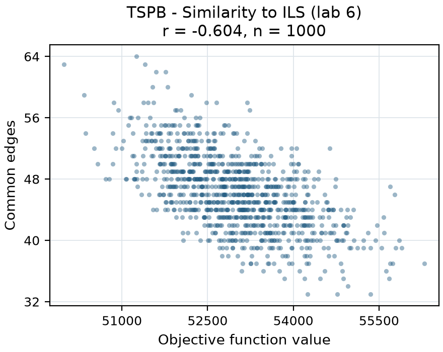

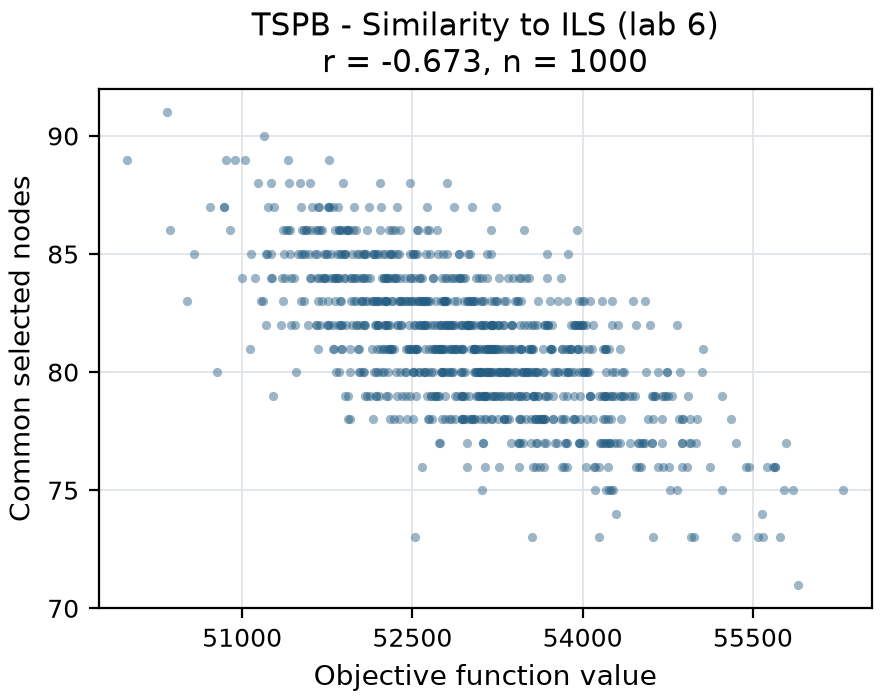

## Source code

- [Experiment runner](../src/lab8_experiment.cpp)
- [Greedy local search](../../lab3/src/local_search_methods.cpp)
- [ILS reference cycles](../../lab6/out/generated/best_solutions.csv)
- [Similarity calculations and report generator](../src/create_report.py)

## Conclusions

All correlations are negative. Lower objective values tend to go with higher similarity. TSPA has the strongest correlation for similarity to ILS (lab 6) using common selected nodes (r = -0.687). TSPB has the strongest correlation for similarity to ILS (lab 6) using common selected nodes (r = -0.673).
